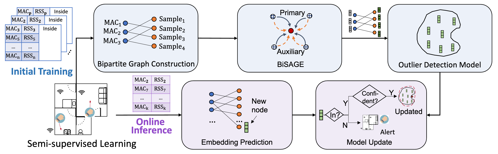

# Semi-supervised Learning with Network Embedding on Ambient RF Signals for Geofencing Services [ICDE 2023]

This is the official implementation of the paper: <br/>
> [**Semi-supervised Learning with Network Embedding on Ambient RF Signals for Geofencing Services**](https://arxiv.org/abs/2210.07889)      
> Weipeng Zhuo, Ka Ho Chiu, Jierun Chen, Jiajie Tan, Edmund Sumpena, Sangtae Ha, S.-H. Gary Chan, Chul-Ho Lee       
> *IEEE International Conference on Data Engineering (ICDE), 2023*

## Overview

In applications such as elderly care, dementia antiwandering and pandemic control, it is important to ensure that people are within a predefined area for their safety and wellbeing. We propose GEM, a practical, semi-supervised Geofencing system with network EMbedding, which is based only on ambient radio frequency (RF) signals. GEM models measured RF signal records as a weighted bipartite graph. With access points on one side and signal records on the other, it is able to precisely capture the relationships between signal records. GEM then learns node embeddings from the graph via a novel bipartite network embedding algorithm called BiSAGE, based on a Bipartite graph neural network with a novel bi-level SAmple and aggreGatE mechanism and non-uniform neighborhood sampling. Using the learned embeddings, GEM finally builds a one-class classification model via an enhanced histogram-based algorithm for in-out detection, i.e., to detect whether the user is inside the area or not. This model also keeps on improving with newly collected signal records. We demonstrate through extensive experiments in diverse environments that GEM shows state-ofthe-art performance with up to 34% improvement in F -score. BiSAGE in GEM leads to a 54% improvement in F -score, as compared to the one without BiSAGE.




## Getting Started

Note: all configurations (required for running) are in **config.py**.

Current **config.py** is the lab dataset.

To run the shopping mall experiment, change the 'data_name' in **config.py** to 'mall'. 'id' in **config.py** shall also be changed correspondingly. For mall, due to the large number of signal records, we split the dataset into parts, thus additional numbering of filename ('parts') in the config.py would be required here.

To run the UJI experiments, change the 'data_name' in **config.py** to 'uji{building_id}'. 'id' in **config.py** shall also be changed correspondingly.

1. Create a new folder **input** (replacing the old one). Put the input under folder **input**, please check the given file for suggested format and naming. In each row, 0 stands for 'in' and 1 stands for 'out'

2. Run **prep_graph.py**, the output would be folders in **emb_output**. This file processes the signal records and generates corresponding bipartite graph. 
In training, the signal records are used to construct an initial bipartite graph. In testing, new MAC nodes and signal-record nodes will be added into the graph.

3. Run **bisage.py** (requires modifying parameters in config.py, in our example, "lab_train" and "lab_test"), the output would be folders in **emb_output/{your data name}/embedding**. This file processes the bipartite graph and generates the embedding for each node using our proposed representation learning algorithm BiSAGE. In training, it generates node embeddings and learns weight matrices through minimizing the loss function. In testing, the embedding of each node is quickly inferenced through aggregation.

4. Run **hbos.py**, the result would be in folder **result**, log files would be in the folder **update_output**. This file builds the initial histogram for outlier detection and generates the raw outlier score for each embedding using the HBOS outlier detection algorithm. 

5. Run **sigmoid_scaling.py**, the result would be in folder **result**. This file applies sigmoid scaling to the outlier scores and detects outliers if any. It also updates the histograms built in the HBOS model if there are any highly confident in-boundary signal records. 

## Bibliography

If you find this work useful, please consider citing it.

```
@INPROCEEDINGS{gem2023,
  author={Zhuo, Weipeng and Chiu, Ka Ho and Chen, Jierun and Tan, Jiajie and Sumpena, Edmund and Chan, S.-H. Gary and Ha, Sangtae and Lee, Chul-Ho},
  booktitle={2023 IEEE 39th International Conference on Data Engineering (ICDE)}, 
  title={Semi-supervised Learning with Network Embedding on Ambient RF Signals for Geofencing Services}, 
  year={2023},
  volume={},
  number={},
  pages={2713-2726},
  keywords={Radio frequency;Weight measurement;Representation learning;Pandemics;RF signals;Semisupervised learning;Robustness},
  doi={10.1109/ICDE55515.2023.00208}}
```
